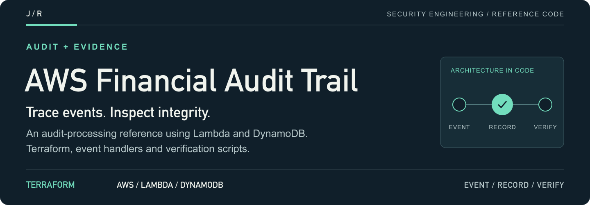
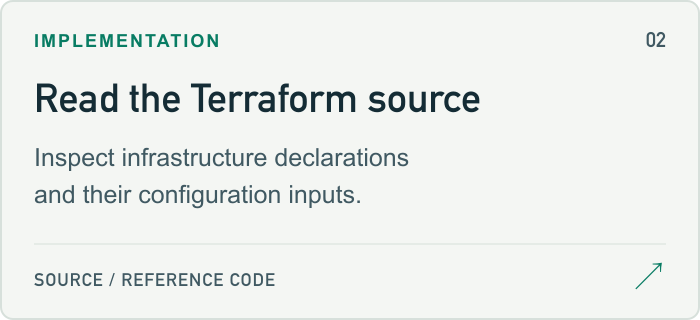
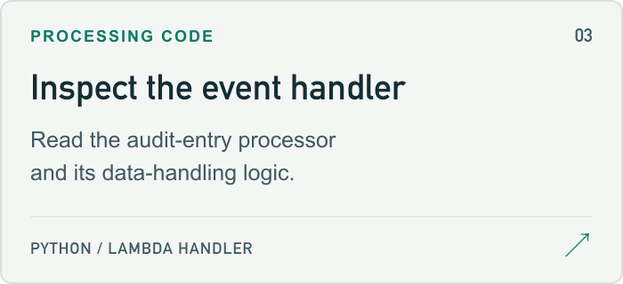
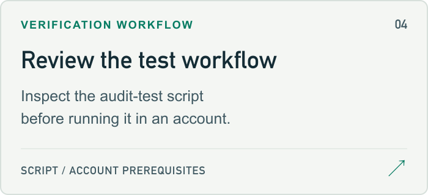

<a id="aws-immutable-financial-audit-trail"></a>

<a href="#setup-guide">
<picture>
  <source media="(max-width: 600px)" srcset="docs/assets/readme/header-mobile.png">
  
</picture>
</a>

<p>
  <a href="#setup-guide"><strong>Start here ↗</strong></a> &nbsp; / &nbsp;
  <a href="main.tf">Source</a> &nbsp; / &nbsp;
  <a href="#project-guide">Project guide</a> &nbsp; / &nbsp;
  <a href="https://github.com/jmragsdale">Profile</a>
</p>

An AWS audit-processing reference with Terraform infrastructure, Lambda handlers and a chain-verification workflow.

## Explore the project

Open a card for source, examples or supporting documentation.

<p>
<a href="aws-audit-trail.svg">
<picture>
  <source media="(prefers-color-scheme: dark)" srcset="docs/assets/readme/architecture-dark.png">
  
</picture>
</a>
<a href="main.tf">
<picture>
  <source media="(prefers-color-scheme: dark)" srcset="docs/assets/readme/source-dark.png">
  
</picture>
</a>
<a href="lambda/processor/index.py">
<picture>
  <source media="(prefers-color-scheme: dark)" srcset="docs/assets/readme/processor-dark.png">
  
</picture>
</a>
<a href="scripts/test-audit.sh">
<picture>
  <source media="(prefers-color-scheme: dark)" srcset="docs/assets/readme/verification-dark.png">
  
</picture>
</a>
</p>

## Project guide

Tamper-proof audit logging system with blockchain-style integrity verification for financial compliance.

## Architecture

- **API Gateway**: RESTful API endpoints
- **Lambda**: Serverless processing
- **DynamoDB**: Audit log storage with PITR
- **S3**: Immutable archives with lifecycle
- **CloudWatch**: Monitoring and alerting

## Features

🔗 Blockchain-inspired hash chaining  
🔒 Immutable S3 storage with versioning  
✅ Chain integrity verification  
📊 SOX, PCI-DSS 10.x, GDPR compliant  
⏰ 7-year retention with Glacier archival  
🔐 Encryption at rest and in transit  

<a id="setup-guide"></a>

## Quick Start

```bash
# Configure AWS CLI
aws configure

# Deploy
./scripts/deploy.sh

# Test
./scripts/test-audit.sh

# View logs
aws logs tail /aws/lambda/audit-trail-processor --follow
```

## API Endpoints

**Create Audit Entry**
```bash
POST /audit
{
  "transactionId": "TXN-001",
  "accountId": "ACC-12345",
  "amount": 1500.00,
  "type": "DEBIT",
  "description": "Wire transfer"
}
```

**Verify Chain**
```bash
GET /audit/{accountId}/verify
```

## How It Works

Each audit entry contains:
- Transaction data
- SHA-256 hash of current entry
- Hash of previous entry (chain link)

Any tampering breaks the chain and is detected.

## Cost Estimate

~$3-15/month for low-volume usage

## Cleanup

```bash
terraform destroy
```

## Talking Points

- Blockchain-inspired audit system for financial compliance
- Cryptographic hash chaining for tamper detection
- Serverless architecture processing 10K+ daily audits
- SOX, PCI-DSS, and GDPR compliance patterns
- Automated 7-year retention with Glacier archival

<details>
<summary>README visual assets</summary>

[Artwork sources and regeneration notes](docs/assets/readme/README.md).

</details>
